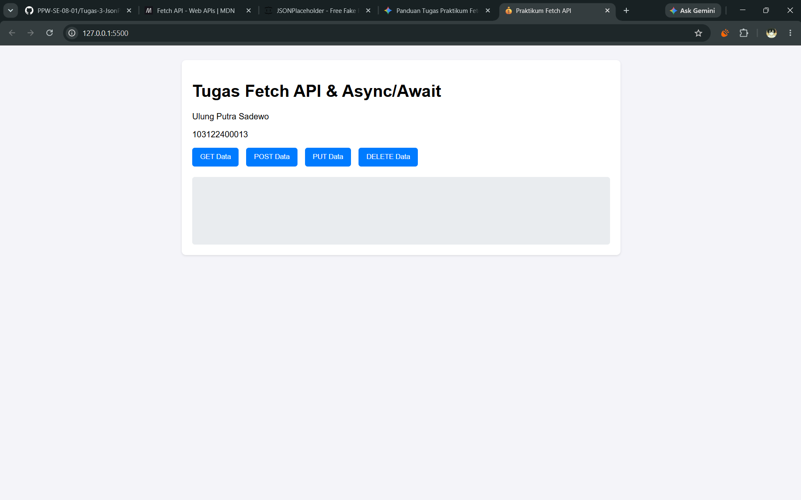

# Tugas Praktikum Pemrograman Web - Fetch API
Ulung Putra Sadewo - 103122400013

Repositori ini berisi implementasi asinkronus JavaScript (async/await) menggunakan Fetch API untuk berinteraksi dengan API publik [JSONPlaceholder](https://jsonplaceholder.typicode.com/).

## Fitur yang Diimplementasikan
Aplikasi ini menampilkan antarmuka berbasis DOM yang melakukan operasi berikut:
1. **GET**: Mengambil data postingan dari API dan merendernya ke dalam elemen HTML.
2. **POST**: Mengirim data payload baru ke API dan menampilkan respons penambahan.
3. **PUT**: Memperbarui data yang sudah ada (ID: 1) dan menampilkan respons perubahan.
4. **DELETE**: Menghapus data (ID: 1) dan memvalidasi status respons.

## Contoh Output

## Teknologi yang Digunakan
- HTML5
- CSS3
- JavaScript (Vanilla, ES6+ Async/Await, DOM Manipulation)
- REST API (JSONPlaceholder)

## Cara Menjalankan Program
1. Clone repositori ini.
2. Buka file `index.html` menggunakan browser atau ekstensi Live Server di VS Code.
3. Klik tombol-tombol yang tersedia untuk melihat hasil response dari setiap HTTP Method di layar.